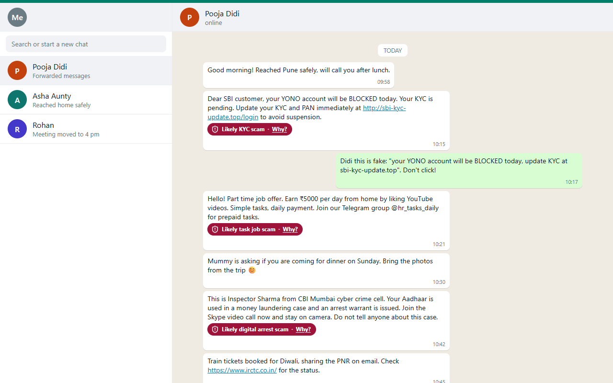
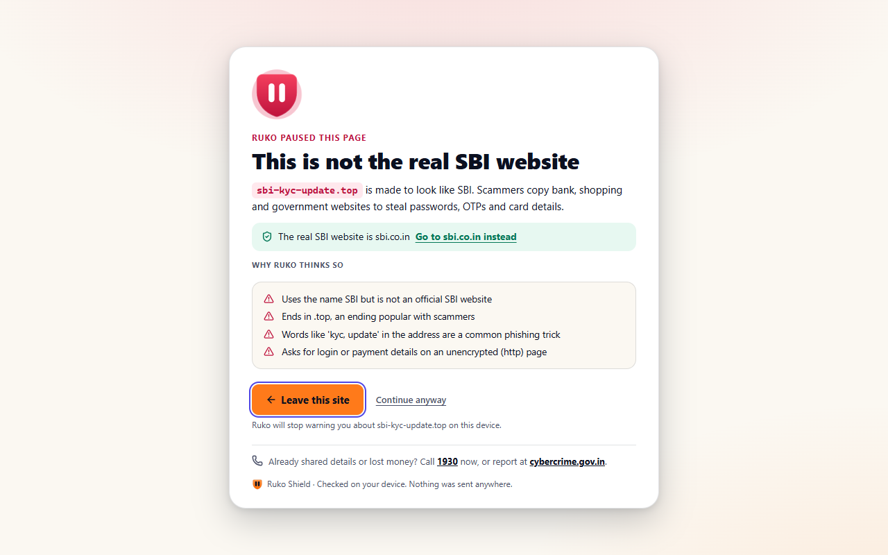

# Ruko

**Pause. Check. Then trust.** · **रुको। जाँचो। फिर भरोसा करो।**

Ruko is an on-device scam shield for India. Paste or share any message, link, UPI ID,
phone number, QR code or screenshot and get a plain-language verdict in English or Hindi,
with the red flags highlighted in your own text and the exact steps to take next.
Nothing you check leaves your device.

**Live:** https://ruko-nu.vercel.app · **Extension:** [Ruko Shield releases](https://github.com/rutvirupani1111/ruko/releases)

<p align="center">
  
</p>

## Why

Indians lose thousands of crores every year to UPI collect requests, fake KYC updates,
"digital arrest" video calls, task-based job offers, investment groups and courier scams.
The people most at risk are the least likely to recognise them, and the tools that exist
are cloud chatbots that read your private messages.

Ruko takes the opposite approach:

- **Private by design.** Detection runs entirely in the browser. The optional community
  lookups use k-anonymity hash ranges (like HaveIBeenPwned), so even the server never learns
  what you checked.
- **Built for India.** 24 scam types, 120+ Indian brands and their official domains, 95 UPI
  handles, TRAI number series (140 telemarketing, 1600 banking), 1930, cybercrime.gov.in and
  Sanchar Saathi Chakshu. English, Hindi and Hinglish.
- **Teaches, not just warns.** A scam-spotting game with an elder mode, a scam
  encyclopedia, and a calm "I think I've been scammed" emergency flow.

## What's in this repository

| Part | Folder | What it is |
|---|---|---|
| **@ruko/engine** | [`engine/`](engine) | Zero-dependency TypeScript detection engine. 96.8% recall and 0% false positives on a 314-message labelled corpus; 1,000 checks in about 0.3 s. Runs in browsers, Node, Web Workers and MV3 service workers. |
| **Ruko web** | [`web/`](web) | Installable PWA (works offline, Android share target): live checking with QR and screenshot OCR, verdict card with highlighted red flags, Learn, Spot-the-scam simulator (21 bilingual scenarios), emergency help with a private complaint-draft generator, community reports with proof-of-work, privacy explainer. Hono API on Postgres. |
| **Ruko Shield** | [`extension/`](extension) | Chrome, Edge and Firefox extension: badges under suspicious WhatsApp Web messages, banners above suspicious Gmail emails, a full-page warning on sites imitating a bank, link safety tooltips and a confirmation before any `upi://` payment link. |

<p align="center">
  
  
  
</p>
<p align="center">
  
  
</p>

## Quick start

```bash
# engine
cd engine && npm install && npm test

# web app (Vite on 5181, API on 5182)
cd web && npm install --legacy-peer-deps && npm run dev

# extension (builds Chrome, Edge and Firefox into .output/)
cd extension && npm install && npm run build
```

Each folder is its own npm project; the web app and the extension import the engine from
source through a Vite alias, so there is no build or link step.

## Quality

| | Tests |
|---|---|
| engine | labelled corpus (188 scams, 126 genuine) + unit tests, benchmark, size budget |
| web | 34 unit tests, 21 Playwright end-to-end tests with axe accessibility checks |
| extension | 99 unit tests, 21 Playwright end-to-end tests against WhatsApp and Gmail DOM fixtures |

## Deploy

The web app runs on Vercel with a Neon Postgres database. Because it imports `../engine`,
deploy with a local build from `web/`: `vercel pull`, `vercel build --prod`,
`vercel deploy --prebuilt --prod`. See [`web/DEPLOY.md`](web/DEPLOY.md).

## License

MIT © Rutvi Rupani
