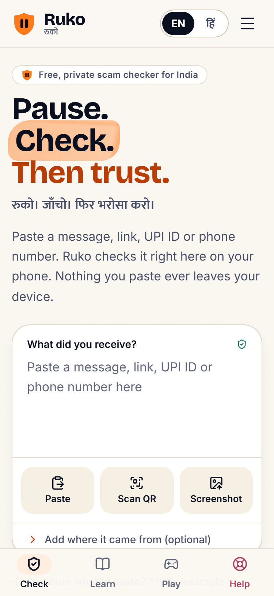
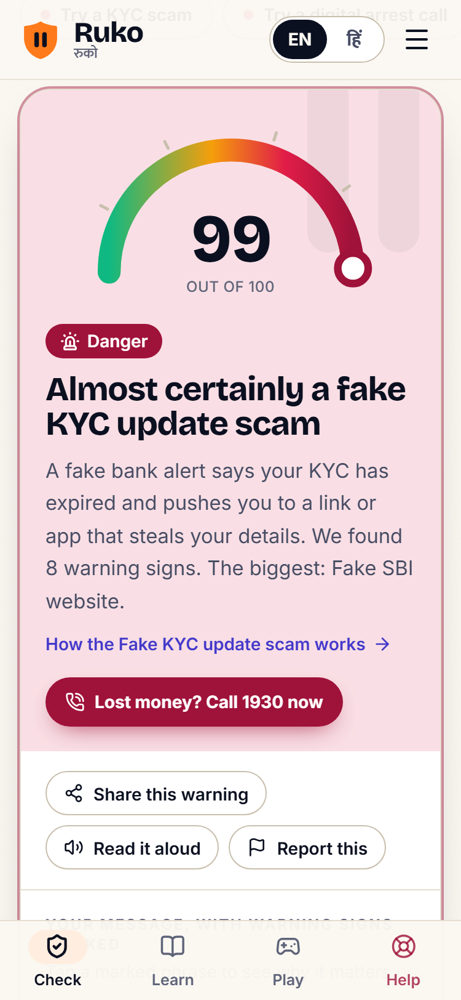
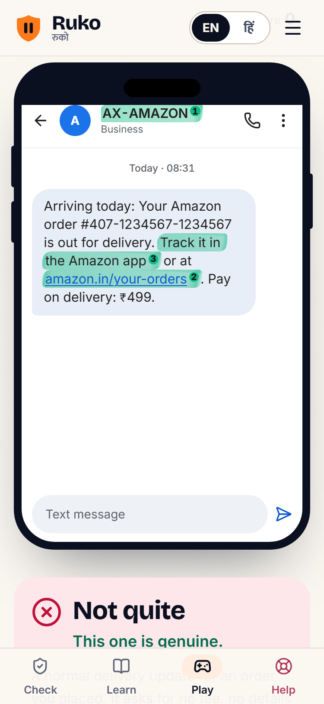
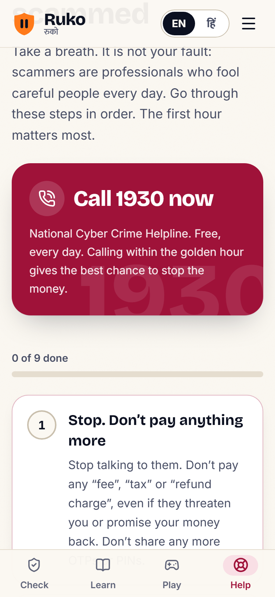
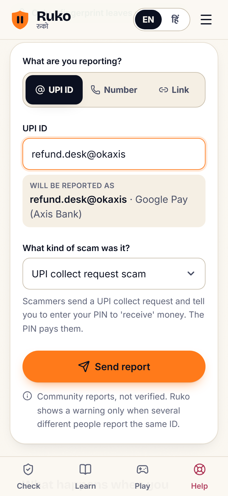
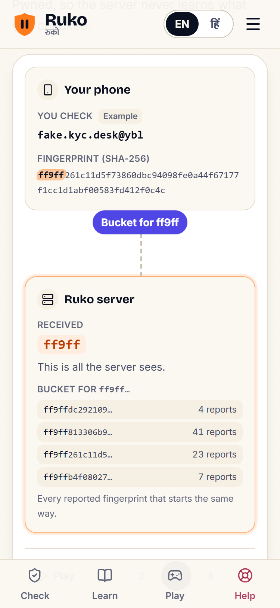
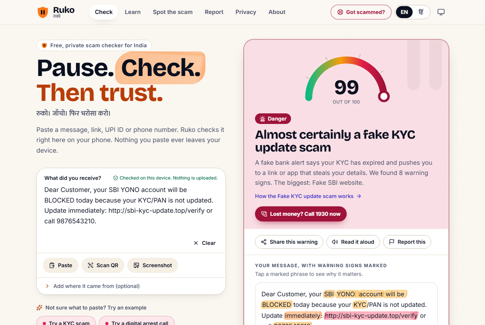

# Ruko web

**Pause. Check. Then trust.** रुको। जाँचो। फिर भरोसा करो।

An on-device scam checker for India, in English and Hindi. Paste a message, link,
UPI ID or phone number and Ruko checks it inside the page, on your own phone.

**Live: https://ruko-nu.vercel.app**

Built with Vite, React 19, Tailwind CSS v4, React Router and vite-plugin-pwa. The
detection engine is imported from source (`../engine/src`, `@ruko/engine`).

| Check | Verdict | Spot the scam |
| :-: | :-: | :-: |
|  |  |  |
| **Got scammed?** | **Report** | **Privacy** |
|  |  |  |



## Features

- **Check** (`/`, share target `/check`): live on-device analysis as you type, verdict
  card with an animated risk meter, red flags highlighted in your own text and linked to
  their explanations, mini-verdicts for every link, UPI ID and number, advice with
  Call 1930 / cybercrime.gov.in / Chakshu, share-as-image, read aloud, QR scan
  (BarcodeDetector or jsQR), screenshot OCR (Tesseract, lazy), Chrome's built-in
  Translator and Prompt APIs when present.
- **Learn** (`/learn`, `/learn/:category`): searchable scam encyclopedia from the engine.
- **Spot the scam** (`/simulator`): 21 bilingual scenarios on WhatsApp, SMS, email, call
  and payment-app mock-ups, three levels, score, streaks, confetti, result card, and elder
  mode (big text, high contrast in light and dark, read aloud).
- **Got scammed?** (`/help`): a calm 9-step emergency checklist (saved on the device) and
  a complaint draft generator in English or Hindi (copy, print, download). Nothing leaves
  the device.
- **Report** (`/report`): report a UPI ID, phone number or link with a scam category.
  Input is validated and normalised with the engine; official websites and helpline short
  codes are refused, and a page on a big platform (Google Forms, Telegram ...) is reported
  as that exact link, never the whole site. Only a SHA-256 fingerprint leaves the phone,
  after a proof-of-work solved in a Web Worker (engine `sha256HexSync`, 18 bits) with a
  progress state and cancel. Success and error states; "community reports, not verified".
- **Privacy** (`/privacy`): how Ruko works without seeing your data, an animated
  k-anonymity diagram (hash on the phone, send 5 characters, get a bucket, match locally;
  play/pause and step controls), a "try it" fingerprint box and the community lookups switch.
- **About** (`/about`): mission, open source links, the Ruko Shield browser extension from
  [GitHub releases](https://github.com/rutvirupani1111/ruko/releases), and a support panel
  whose unset donation links are clearly marked "Not set up yet".
- **Community API** (`server/`, `api/`): k-anonymity range lookups, proof-of-work reports,
  30-day stats, health. PGlite locally, Postgres (Neon) in production. Raw identifiers and
  IP addresses are never stored.
- **PWA**: installable, works offline (engine, app shell, Learn, simulator), share target,
  icons generated from the SVG mark.
- English and Hindi everywhere, light and dark themes, WCAG 2.2 AA colour tokens, keyboard
  reachable, reduced-motion aware. Initial JS about 133 KB gzip (budget 150 KB).

## Commands

```bash
npm install --legacy-peer-deps
npm run dev          # Vite on :5181 + API on :5182 (Vite proxies /api)
npm run build        # production build + bundle budget check
npm run preview      # serve dist/ on :5181
npm run typecheck
npm test             # vitest: UI logic, PoW, report input, scenarios, complaint draft, API on PGlite
npm run e2e          # Playwright (Chromium) against a production build, API mocked
npm run screenshots  # README screenshots into docs/screenshots (needs `npm run preview` running)
npm run icons        # regenerate icons and og.png from the mark
```

The e2e suite (`e2e/`, `playwright.config.ts`) builds with `--mode e2e`, serves it with
`vite preview` on :5181 and mocks `/api` per test. It covers the check flow (KYC sample to a
critical verdict with highlights), the Hindi switch, a full simulator run, the help
checklist and complaint draft, the report form through the proof-of-work step, privacy and
about, axe checks (light and dark) and an offline reload once the service worker is
installed. Playwright 1.61.1 uses Chromium 1228 (`npx playwright install chromium`).

## Configuration

- `VITE_RUKO_API` (build time): `/api` turns community features on. Set in
  `.env.production`, `.env.development` and `.env.e2e`. Unset means reports and lookups are
  off and `/report` explains why.
- `src/config.ts`: repository, releases and issues links, extension store listings and
  support links. Anything with `placeholder: true` is shown as "Not set up yet" instead of
  linking somewhere fake.

Deployment: see `DEPLOY.md`. Build log and open items: `docs/STATUS.md`.
